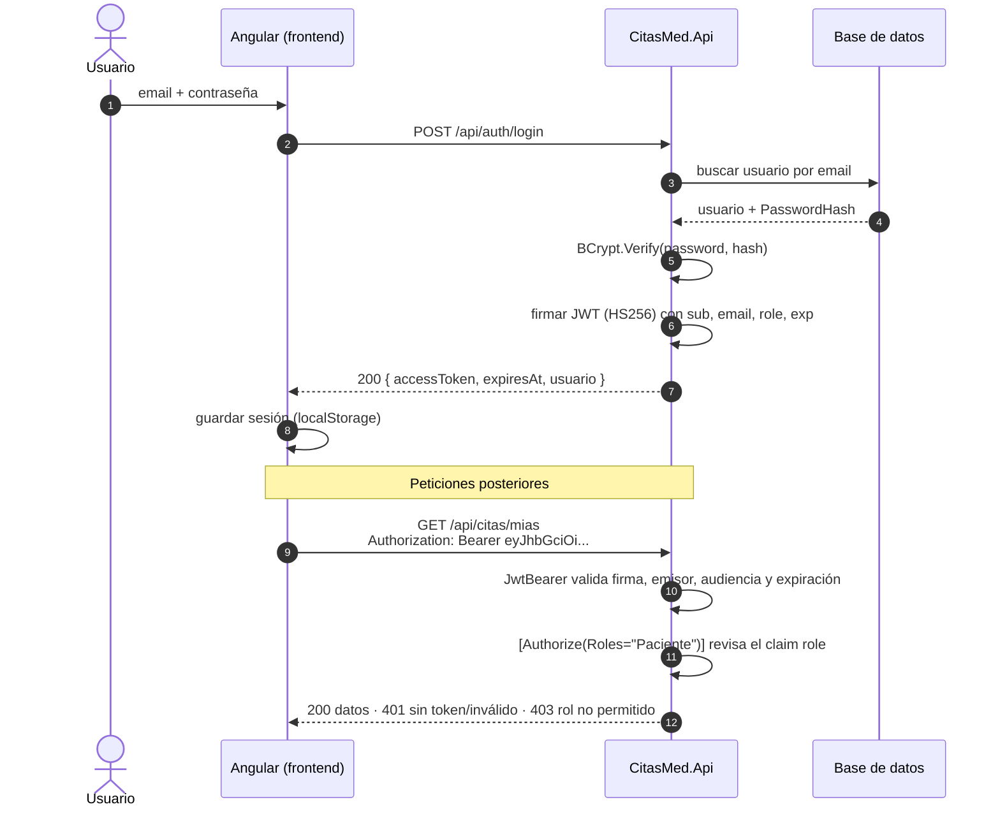

# Problema 1 — Seguridad: login con JWT

> Implementación real en este repositorio (CitasMed): backend .NET 10 en capas + frontend Angular 21.

## 1. Flujo completo



## 2. Cómo se emite el token

**Pseudocódigo**

```text
función login(email, password):
    usuario ← repositorio.buscarPorEmail(normalizar(email))
    si usuario es nulo  O  NO bcrypt.verificar(password, usuario.hash):
        lanzar 401 "Email o contraseña incorrectos."      # mismo mensaje en ambos casos
    claims ← { sub: usuario.id, email, name, role: usuario.rol, jti: uuid() }
    token  ← firmar_HMAC_SHA256(header + claims + exp(ahora + 60 min), CLAVE_SECRETA)
    devolver { accessToken: token, expiresAt, usuario }
```

**Código real** — [`AuthService.cs`](../backend/src/CitasMed.Application/Features/Auth/AuthService.cs) y [`JwtService.cs`](../backend/src/CitasMed.Infrastructure/Security/JwtService.cs):

```csharp
var user = await users.GetByEmailAsync(email, ct);
if (user is null || !hasher.Verify(request.Password, user.PasswordHash))
    throw new UnauthorizedException("Email o contraseña incorrectos.");

var descriptor = new SecurityTokenDescriptor
{
    Issuer = _options.Issuer, Audience = _options.Audience,
    Expires = now.AddMinutes(_options.ExpiresMinutes),
    SigningCredentials = new SigningCredentials(key, SecurityAlgorithms.HmacSha256),
    Claims = new Dictionary<string, object>
    {
        ["sub"] = user.Id.ToString(), ["email"] = user.Email,
        ["name"] = user.Nombre, ["role"] = user.Rol.ToString(), ["jti"] = Guid.NewGuid().ToString()
    }
};
return new TokenResult(_handler.CreateToken(descriptor), expires);
```

Un JWT tiene tres partes separadas por puntos: `header.payload.firma`.
Payload real emitido por la API (decodificado):

```json
{ "sub": "2", "email": "paciente@citasmed.test", "name": "Paciente Demo", "role": "Paciente",
  "iss": "CitasMed.Api", "aud": "CitasMed.Frontend", "iat": 1794598985, "exp": 1794602585, "jti": "6478…" }
```

> ⚠️ El payload está codificado en Base64Url, **no cifrado**: cualquiera puede leerlo. Por eso nunca se incluyen contraseñas ni datos sensibles. Lo que garantiza la firma es que **nadie puede modificarlo** sin conocer la clave: si se altera un solo carácter, la API responde `401`.

Buenas prácticas aplicadas:

- Contraseñas guardadas con **BCrypt** (hash con sal), nunca en texto plano.
- La clave de firma (`Jwt:Key`, mínimo 32 caracteres) **no está en el código**: viene de configuración o variable de entorno, y la app no arranca si falta (`ValidateOnStart`).
- Expiración corta (60 min) y `ClockSkew` de 30 s.
- Mismo mensaje para "email no existe" y "contraseña incorrecta", así no se revela qué cuentas existen.

## 3. Dónde guarda el token el frontend

En [`auth.service.ts`](../frontend/src/app/core/auth/auth.service.ts) la sesión (`accessToken`, `expiresAt`, `usuario`) se guarda en **`localStorage`** y en un `signal` en memoria. Al recargar la página se restaura, y si ya expiró se descarta.

| Opción | Ventaja | Riesgo |
|---|---|---|
| `localStorage` *(usada)* | Simple, sobrevive a recargas, fácil de enviar como `Bearer` | Accesible desde JavaScript → vulnerable a **XSS** |
| Solo memoria | No persiste en disco | Se pierde al recargar |
| Cookie `HttpOnly` + `Secure` + `SameSite` | JavaScript no puede leerla (mitiga XSS) | Requiere protección CSRF y configuración del backend |

Mitigaciones del riesgo XSS en este proyecto: Angular escapa el HTML por defecto, el token expira pronto y no lleva datos sensibles.

El token se envía automáticamente con un **interceptor** ([`auth.interceptor.ts`](../frontend/src/app/core/auth/auth.interceptor.ts)), y **solo** a nuestra API:

```ts
export const authInterceptor: HttpInterceptorFn = (req, next) => {
  const token = inject(AuthService).token;
  if (!token || !req.url.startsWith(environment.apiUrl)) return next(req);
  return next(req.clone({ setHeaders: { Authorization: `Bearer ${token}` } }));
};
```

## 4. Cómo protege el backend un endpoint

**a) Middleware de autenticación** ([`AuthExtensions.cs`](../backend/src/CitasMed.Api/Extensions/AuthExtensions.cs)): valida cada token entrante.

```csharp
.AddJwtBearer(o => o.TokenValidationParameters = new TokenValidationParameters
{
    ValidateIssuer = true,  ValidIssuer = jwt.Issuer,
    ValidateAudience = true, ValidAudience = jwt.Audience,
    ValidateIssuerSigningKey = true, IssuerSigningKey = new SymmetricSecurityKey(key),
    ValidateLifetime = true, RoleClaimType = "role"
});

// Política global: TODO endpoint exige usuario autenticado salvo [AllowAnonymous]
services.AddAuthorizationBuilder().SetFallbackPolicy(
    new AuthorizationPolicyBuilder().RequireAuthenticatedUser().Build());
```

```csharp
app.UseCors(...);
app.UseAuthentication();   // ¿quién eres?        → lee y valida el JWT
app.UseAuthorization();    // ¿qué puedes hacer?  → [Authorize], roles
```

**b) Autorización por rol en el controlador** ([`CitasController.cs`](../backend/src/CitasMed.Api/Controllers/CitasController.cs)):

```csharp
[HttpPatch("{id:int}/atender")]
[Authorize(Roles = nameof(Rol.Medico))]          // otro rol → 403
public async Task<ActionResult<CitaDto>> Atender(int id, CancellationToken ct)
    => Ok(await service.AtenderAsync(id, ct));
```

**c) Autorización por recurso en el caso de uso** ([`CitaService.cs`](../backend/src/CitasMed.Application/Features/Citas/CitaService.cs)): tener el rol no basta, la cita tiene que ser **tuya**.

```csharp
if (currentUser.Rol != nameof(Rol.Admin) && !cita.PerteneceA(UsuarioId()))
    throw new ForbiddenException("Solo puedes cancelar tus propias citas.");   // → 403
```

## 5. Autenticación vs. autorización

| | Autenticación | Autorización |
|---|---|---|
| Pregunta | **¿Quién eres?** | **¿Qué puedes hacer?** |
| Cuándo | En el login y al validar el token en cada petición | Después de autenticar, en cada endpoint o recurso |
| En CitasMed | `POST /api/auth/login`, BCrypt, `UseAuthentication()` + JwtBearer | `[Authorize(Roles=...)]`, `roleGuard`, `cita.PerteneceA(...)` |
| Si falla | **401 Unauthorized** | **403 Forbidden** |

Evidencia (respuestas reales de la API, también cubiertas por pruebas de integración):

| Petición | Resultado |
|---|---|
| `GET /api/citas/mias` sin token | `401` |
| Token con la firma alterada | `401` |
| Paciente → `GET /api/usuarios` (solo Admin) | `403` |
| Paciente 2 → cancelar la cita del Paciente 1 | `403` "Solo puedes cancelar tus propias citas." |
| Médico B → atender una cita del Médico A | `403` |
| Admin → `GET /api/usuarios` | `200` |

### English requirement

> **Authentication** is the process of verifying *who* a user is: in CitasMed, the API checks the email and password against a BCrypt hash and, if they match, issues a signed JWT that the client sends on every request. **Authorization** happens afterwards and decides *what* that authenticated user is allowed to do, for example only a Doctor can mark an appointment as attended and a Patient can only cancel their own appointments. When authentication fails the API returns **401 Unauthorized**, while a valid user without the required permission receives **403 Forbidden**.
