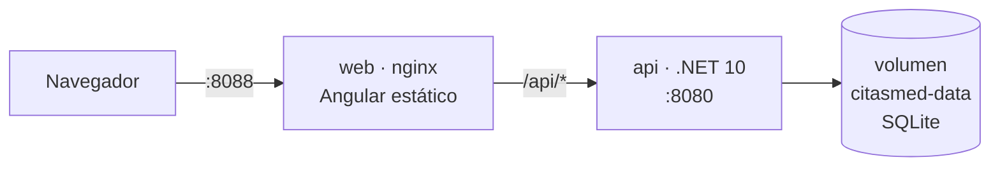

# Problema 3 — Contenedores y despliegue

## 1. Dockerfile del backend

[`backend/Dockerfile`](../backend/Dockerfile) — **multi-stage**: se compila con el SDK y se ejecuta solo con el runtime.

```dockerfile
# ---------- Etapa 1: build ----------
FROM mcr.microsoft.com/dotnet/sdk:10.0 AS build
WORKDIR /src

# 1) Solo los .csproj → la capa de "restore" se cachea mientras no cambien las dependencias
COPY src/CitasMed.Domain/CitasMed.Domain.csproj                 src/CitasMed.Domain/
COPY src/CitasMed.Application/CitasMed.Application.csproj       src/CitasMed.Application/
COPY src/CitasMed.Infrastructure/CitasMed.Infrastructure.csproj src/CitasMed.Infrastructure/
COPY src/CitasMed.Api/CitasMed.Api.csproj                       src/CitasMed.Api/
RUN dotnet restore src/CitasMed.Api/CitasMed.Api.csproj

# 2) Código fuente + publicación Release
COPY src/ src/
RUN dotnet publish src/CitasMed.Api/CitasMed.Api.csproj -c Release -o /app/publish --no-restore /p:UseAppHost=false

# ---------- Etapa 2: runtime ----------
FROM mcr.microsoft.com/dotnet/aspnet:10.0 AS runtime
WORKDIR /app
RUN mkdir -p /app/data && chown app:app /app/data     # volumen para SQLite
COPY --from=build /app/publish .

ENV ASPNETCORE_URLS=http://+:8080 \
    ASPNETCORE_ENVIRONMENT=Production \
    ConnectionStrings__Default="Data Source=/app/data/citasmed.db"
EXPOSE 8080
USER app                                              # sin privilegios de root
ENTRYPOINT ["dotnet", "CitasMed.Api.dll"]
```

| Decisión | Por qué |
|---|---|
| Multi-stage (`sdk` → `aspnet`) | La imagen final no lleva el SDK ni el código fuente: es más pequeña y tiene menos superficie de ataque |
| Copiar `.csproj` antes que el código | Docker reutiliza la capa de `restore` si solo cambió el código (builds más rápidos) |
| `USER app` | Si alguien compromete la app, no obtiene privilegios de root dentro del contenedor |
| Sin secretos en la imagen | `Jwt__Key` **no** está en el Dockerfile; se inyecta al ejecutar (verificado con `docker image inspect`) |
| [`.dockerignore`](../backend/.dockerignore) | Excluye `bin/`, `obj/`, `tests/` y bases `.db` locales del contexto de build |

El frontend usa el mismo patrón ([`frontend/Dockerfile`](../frontend/Dockerfile)): `node:22-alpine` compila Angular y `nginx:alpine` sirve los estáticos (imagen de unos 74 MB), con *fallback* SPA y proxy `/api → api:8080`.

## 2. Pasos para desplegar

### A) Local con Docker Compose (verificado)



1. Clonar el repositorio y entrar a `15-week/c3-parcial`.
2. Crear el archivo de variables a partir de la plantilla y definir una clave segura:

   ```bash
   cp .env.example .env
   ```

   ```bash
   openssl rand -base64 48
   ```

   Pega el resultado en `JWT_KEY=` dentro de `.env` (el archivo está en `.gitignore`).
3. Construir y levantar los dos contenedores:

   ```bash
   docker compose up --build -d
   ```

4. Abrir la app en `http://localhost:8088`. Swagger queda en `http://localhost:5080/swagger` y el estado de salud en `http://localhost:5080/health`.
5. Detener (los datos persisten en el volumen `citasmed-data`):

   ```bash
   docker compose down
   ```

Al arrancar, la API aplica las migraciones (`Database__MigrateOnStartup=true`) y, si `SEED_DEMO_DATA=true`, crea los usuarios de demostración. Se verificó que tras `docker compose restart api` los datos se mantienen y el seed no se duplica.

### B) En la nube (ejemplo: Azure Container Apps o Render)

1. **Publicar las imágenes** en un registro (Docker Hub, GitHub Container Registry o Azure Container Registry):

   ```bash
   docker build -t <usuario>/citasmed-api:1.0 ./backend
   ```

   ```bash
   docker push <usuario>/citasmed-api:1.0
   ```

   (Igual con `citasmed-web`).
2. **Base de datos administrada**: en la nube conviene usar un servicio (Azure SQL o PostgreSQL) en lugar de SQLite en un volumen. Basta con cambiar el proveedor de EF Core en `Infrastructure` y la cadena `ConnectionStrings__Default`. Las otras capas no cambian (ventaja de la arquitectura en capas).
3. **Crear el servicio de la API** apuntando a la imagen, con el puerto 8080 y las variables de entorno de la tabla siguiente. Los secretos (`Jwt__Key`, cadena de conexión) se cargan como **secretos** del proveedor, no como texto plano.
4. **Crear el servicio web** (nginx) o publicar el `dist/` de Angular en un hosting estático. Si quedan en dominios distintos, agregar el dominio del frontend en `Cors__AllowedOrigins`.
5. **HTTPS** lo termina el proveedor (certificado administrado); el health check del servicio apunta a `/health`.
6. **CI/CD (opcional)**: un workflow de GitHub Actions que ejecute `dotnet test` y `ng test`, construya las imágenes y las publique en cada push a `main`.

## 3. Variables de entorno

ASP.NET Core lee la configuración en capas (`appsettings.json` → `appsettings.{Environment}.json` → **variables de entorno**). El doble guion bajo `__` representa la jerarquía: `Jwt__Key` equivale a `Jwt:Key`.

| Variable | Ejemplo | ¿Secreta? | Por qué va en variable de entorno |
|---|---|---|---|
| `Jwt__Key` | *(48+ caracteres aleatorios)* | **Sí** | Quien la conozca puede **falsificar tokens** de cualquier rol. Nunca se sube a Git y es distinta en cada entorno |
| `ConnectionStrings__Default` | `Data Source=/app/data/citasmed.db` | **Sí** (en servidores reales incluye usuario y contraseña) | Cada entorno usa una base distinta; las credenciales no van en el código |
| `Jwt__Issuer` / `Jwt__Audience` | `CitasMed.Api` / `CitasMed.Frontend` | No | Identifican quién emite y para quién es el token; pueden variar por entorno |
| `Jwt__ExpiresMinutes` | `60` | No | Ajustar la duración de la sesión sin recompilar |
| `Cors__AllowedOrigins` | `https://citasmed.midominio.com` | No | El dominio del frontend cambia entre local, pruebas y producción |
| `ASPNETCORE_ENVIRONMENT` | `Production` | No | Activa o desactiva comportamientos (Swagger, páginas de error detalladas, seed) |
| `Database__MigrateOnStartup` | `true` | No | Decidir por entorno si la app aplica migraciones al arrancar |
| `Database__SeedDemoData` | `false` en producción | No | Los usuarios de demostración **no** deben existir en producción |
| `Swagger__Enabled` | `false` en producción | No | No exponer la documentación de la API públicamente |

**¿Por qué variables de entorno y no valores en el código?**

1. **Seguridad**: los secretos no quedan en el repositorio ni en la imagen Docker (cualquiera con acceso podría leerlos).
2. **Una sola imagen para todos los entornos**: la misma `citasmed-api:1.0` sirve en local, pruebas y producción. Solo cambia la configuración que se le inyecta, sin recompilar (principio *Config* de 12-Factor App).
3. **Rotación sencilla**: cambiar la clave JWT o la contraseña de la base es reiniciar el contenedor con el nuevo valor.
4. **Fallar rápido**: si `Jwt__Key` falta o tiene menos de 32 caracteres, la API **no arranca** (`ValidateOnStart`), y `docker compose` exige `JWT_KEY` (`${JWT_KEY:?...}`).

Las plantillas están en [`.env.example`](../.env.example) (sin valores secretos) y en [`docker-compose.yml`](../docker-compose.yml).
